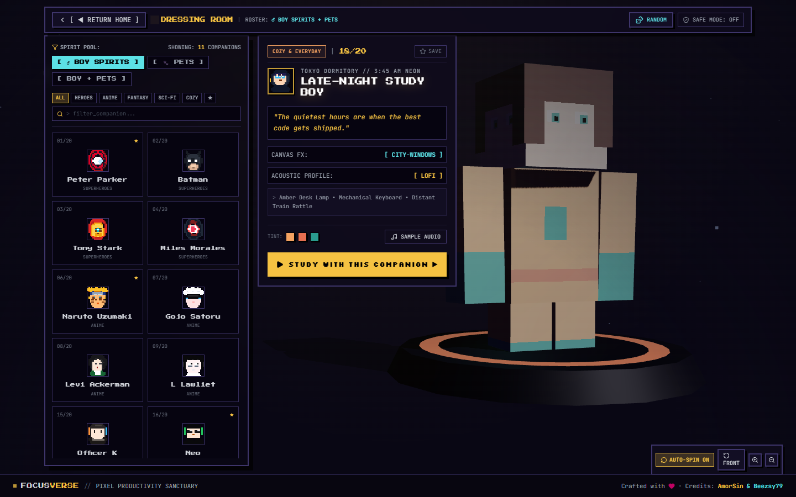
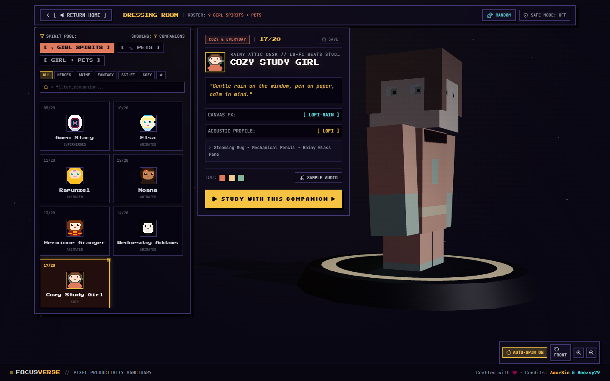

# FocusVerse // Pixel-Arcade & Live-Code Character Productivity Platform

FocusVerse is an immersive, retro-futuristic productivity environment inspired by **Synergy'26 (IIIT-Bangalore)** and cosmic live-code visualizers, featuring an interactive 3D Character Dressing Room inspired by **Minecraft Pocket Edition / Bedrock Edition**.

---

## ✦ Key Architectural Systems

### 1. Living Animated Background & Decluttered 2-Column Homepage (`HomePage.tsx`)
* **Living Animated Atmosphere (`HomeAmbientBackground.tsx`):**
  * Multi-layered twilight & aurora gradient wash (`#0B0C1E`, `#3B1D38`, `#4A2525`, `#102A3A`).
  * High-performance 60fps HTML5 Canvas with 130+ twinkling stars, mouse parallax reaction, 25+ drifting warm bokeh lanterns/fireflies, and periodic shooting star comets with glowing gradient tails.
  * Layered mountain & skyline horizon silhouette with warm flickering building windows.
  * Semi-transparent glassmorphic panels (`backdrop-blur-md bg-[#121026]/75 border border-white/15 shadow-2xl`).
* **Left Column (Decluttered Brand, Orbit & Telemetry):**
  * Live quote banner and signature retro-arcade `FOCUSVERSE` logo breathing cleanly without clutter.
  * Interactive 3D rotating pixel globe (`CosmicGlobe.tsx`) with dynamic LO/HI boundary measurement guides.
  * Segmented live counter blocks (`20 WORLDS ROSTER`, `4 FLOW TOOLS`, `100% SYNTH CHIPTUNE`, `0 DISTRACTIONS`).
  * Direct session launcher (`[ ► LAUNCH QUICK SESSION ► ]`) cleanly aligned below the stats.
* **Right Column ("LOCK IN" Gateway & Ultra-Minimalist 9:16 Cards):**
  * **Initial State:** High-impact arcade gateway box with glowing golden-amber CTA button `[ 🔒 LOCK IN ► ]`.
  * **Revealed State:** Smoothly reveals the `CHOOSE A COMPANION` heading with two adjacent ultra-minimalist portrait cards in strict `9:16` aspect ratio (`SpiritCard.tsx`):
    1. **Study Girl Spirit (`aspect-[9/16]`):** Rich sunset amber, terracotta, and rose-gold atmosphere with floating warm fairy lights, large-scale pixel art illustration, and clean bottom label (`STUDY GIRL` / `Cozy Flow` + `→`).
    2. **Study Boy Spirit (`aspect-[9/16]`):** Deep midnight sapphire, indigo, and cyan atmosphere with twinkling night-sky particles, large-scale pixel art illustration, and clean bottom label (`STUDY BOY` / `Night Focus` + `→`).
  * Selecting either card instantly navigates to the 3D Dressing Room pre-filtered to that companion spirit!

---

### 2. Full-Screen Unboxed 3D Dressing Room & Strict Spirit Filtering (`SelectPage.tsx`)
* **Strict Spirit Filtering (Chosen Gender Spirit + Pets Only):**
  * Removing generic `ALL SPIRITS` clutter — the dressing room strictly respects the companion chosen on the Homepage:
    * **If Study Boy was selected:** Displays only `[ ♂ BOY SPIRITS ]` (default), `[ 🐾 PETS ]`, or `[ BOY + PETS ]`. Girl spirits are completely hidden in that session.
    * **If Study Girl was selected:** Displays only `[ ♀ GIRL SPIRITS ]` (default), `[ 🐾 PETS ]`, or `[ GIRL + PETS ]`. Boy spirits are completely hidden in that session.
  * Category filters (`ALL`, `HEROES`, `ANIME`, `FANTASY`, `SCI-FI`, `COZY`, `★`) and real-time search filter strictly within that active pool.
* **Full-Screen Unboxed 3D Background Plane (`CharacterVoxelStage.tsx`):**
  * Powered by **Three.js** WebGL rendering across the entire viewport (`fixed inset-0 w-screen h-screen z-0`).
  * 3D character rig and glowing rune pedestal anchored proudly on the open right side of the screen (~68%–71% width).
  * 360° drag-to-rotate interaction across the open right plane with momentum physics.
  * Idle breathing, arm swaying animations, and dynamic lighting (key light, spotlight, rim light, and soft floor shadows).
  * Floating camera control pill in the bottom-right corner: `[ AUTO-SPIN ]`, `[ FRONT ]`, `[ + ]`, `[ - ]`.
* **Layered Translucent UI Pop-Ups (`z-10` / `z-20`):**
  * **Top Floating Tactical HUD Bar (`z-20`):** `[ ◀ RETURN HOME ]`, active spirit roster readout, `[ 🎲 RANDOM ]`, and `[ 🛡️ SAFE MODE ]`.
  * **Leftmost Pop-Up Window (Character Choosing Roster):** Anchored to the far left with spirit pills, compact category tabs, search input, and a 2-column vertical roster grid.
  * **Center-Left Floating Pop-Up Window (Character Description & Launch Card):** Displays category, 16x16 face, name/archetype, personality quote, Canvas FX, acoustic profile, color swatches, `[ SAMPLE AUDIO ]`, and the golden `[ STUDY WITH THIS COMPANION ▶ ]` button.
* **16x16 Pixel Art Character Faces (`PixelFaceAvatar.tsx`):**
  * Dedicated high-performance SVG pixel component with crisp edges (`shape-rendering="crispEdges"`, `image-rendering="pixelated"`).
  * Authentic, custom-crafted 16x16 pixel face/head matrices for all 20 companions (Spider-Man, Batman with cowl & bat ears, Iron Man helmet, Miles Morales, Gwen Stacy hood, Naruto shinobi headband, Gojo blindfold, Levi, L Lawliet dark circles, Elsa braid, Rapunzel, Moana, Hermione, Wednesday twin braids, Officer K cyberpunk lighting, Neo Matrix shades, Cozy Study Girl, Late-Night Study Boy, Purring Cat, and Loyal Dog).
  * Displayed on every roster slot in the leftmost pop-up and next to the companion's title in the description pop-up!

---

### 3. Study Workspaces & Header Audio Engine (`WorkspacePage.tsx`)
* **Clean Vertical Breathing Room:** Bottom drawers removed in favor of maximum vertical screen space.
* **Top Header Audio Pill:** Compact `SOUND: [ACTIVE / OFF]` control in the top HUD that toggles a floating audio engine popover:
  * Procedural Ambience Generator (`rain`, `fire`, `space`, `lofi`, `matrix`, `purr`, `sonar`, `wind`) with independent volume slider.
  * 8-Bit Chiptune Synth Melody arpeggiator with volume slider.
  * Master mute switch.
* **Atmosphere Canvas Layer (`EnvironmentFX.tsx`):** 20 canvas particle modes (pixel rain, matrix code, radar grid, rising lanterns, snow crystals, embers) with background dimmer slider (20% to 95%).
* **Multi-Mode Drift-Free Timer (`TimerWidget.tsx`):** Pomodoro, Stopwatch (with lap recording and centiseconds), and Countdown modes with timestamp calculations preventing background tab throttling.
* **Persistent Task Manager (`TodoWidget.tsx`):** Priority tagging (`HIGH`, `MED`, `LOW`), `localStorage` sync, and celebratory pixel-spark canvas bursts.
* **Monospace Scratchpad (`NotesWidget.tsx`):** Real-time word and character counters with `.txt` file export.

---

### 4. Global Credits Footer (`Footer.tsx`)
* Persistent dark pixel-arcade footer displayed across all pages:
  * `FOCUSVERSE // PIXEL PRODUCTIVITY SANCTUARY`
  * `Crafted with ♥ • Credits: AmorSin & Beezsy79`

---

## ✦ Interface Showcase

| Living Background & Decluttered Homepage | Revealed Ultra-Minimalist 9:16 Companion Cards |
| :---: | :---: |
|  |  |

| 3D Dressing Room (Boy Spirits + Pets) | 3D Dressing Room (Girl Spirits + Pets) |
| :---: | :---: |
|  |  |

| Workspace with Top Audio Engine Popover | Batman Batcave Sonar Stage |
| :---: | :---: |
|  |  |

---

## ✦ Getting Started

### Local Development
```bash
# Double-click run_locally.bat or run:
npm run dev -- --host
```
Server boots at `http://localhost:5173/`.

### Production Build & Preview
```bash
# Double-click build_and_preview.bat or run:
npm run build
npm run preview
```

---

## ✦ Credits
Crafted with ♥ • Credits: **AmorSin** & **Beezsy79**
