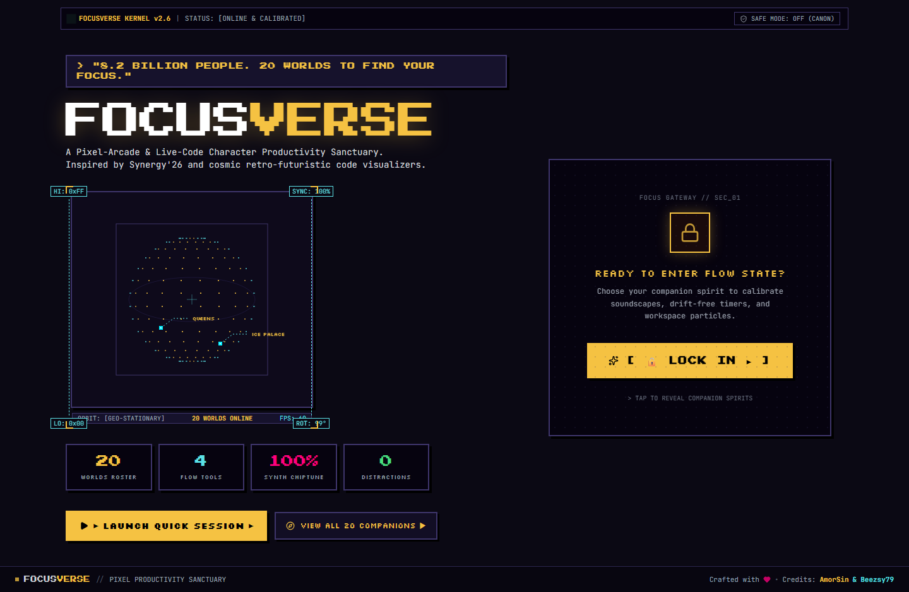
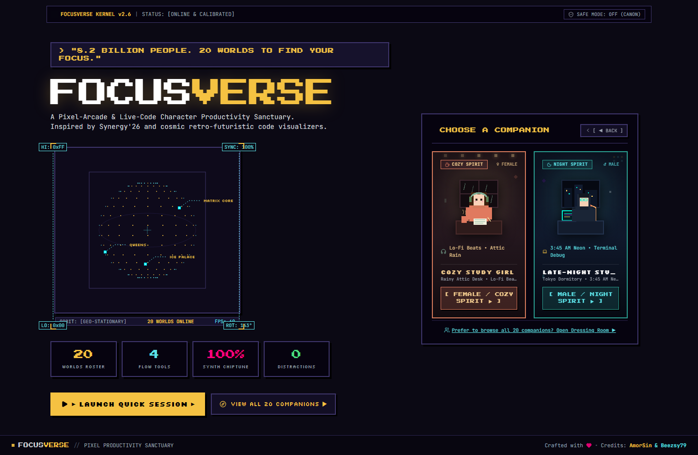
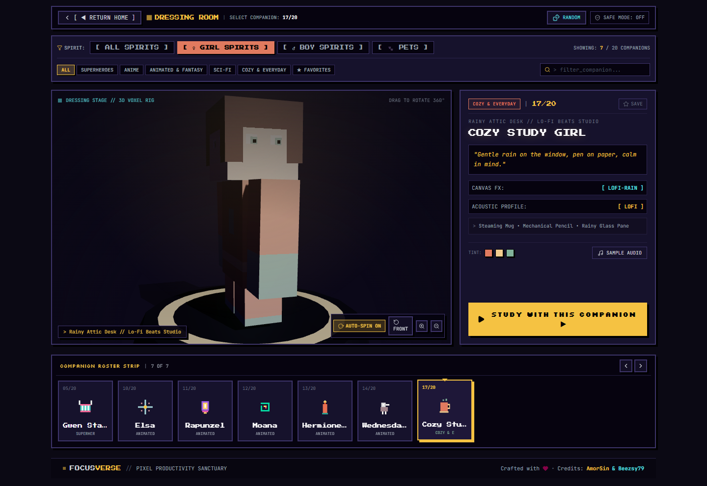
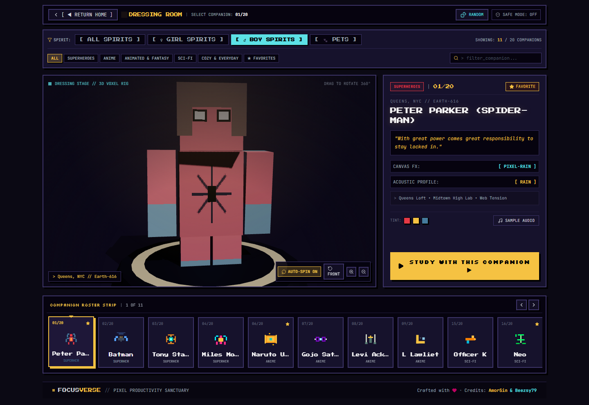

# FocusVerse // Pixel-Arcade & Live-Code Character Productivity Platform

FocusVerse is an immersive, retro-futuristic productivity environment inspired by **Synergy'26 (IIIT-Bangalore)** and cosmic live-code visualizers, featuring an interactive 3D Character Dressing Room inspired by **Minecraft Pocket Edition / Bedrock Edition**.

---

## ✦ Key Architectural Systems

### 1. 2-Column Split Homepage & Interactive "LOCK IN" Gateway (`HomePage.tsx`)
* **Left Column (Brand, Orbit & Telemetry):**
  * Live quote banner, signature retro-arcade `FOCUSVERSE` logo, and cosmic subtitle.
  * Interactive 3D rotating pixel globe (`CosmicGlobe.tsx`) with dynamic LO/HI boundary measurement guides.
  * Segmented live counter blocks (`20 WORLDS ROSTER`, `4 FLOW TOOLS`, `100% SYNTH CHIPTUNE`, `0 DISTRACTIONS`).
  * Direct session launcher (`[ ► LAUNCH QUICK SESSION ► ]`) and full companion directory links.
* **Right Column ("LOCK IN" Gateway & 9:16 Spirit Cards):**
  * **Initial State:** High-impact arcade gateway box with glowing golden-amber CTA button `[ 🔒 LOCK IN ► ]`.
  * **Revealed State:** Smoothly reveals the `CHOOSE A COMPANION` heading with two adjacent portrait cards in strict `9:16` aspect ratio (`SpiritCard.tsx`):
    1. **Cozy Study Girl Spirit (`aspect-[9/16]`):** Warm terracotta, sage green, autumn rain/leaves particles, steaming mug, and lo-fi attic headphones.
    2. **Late-Night Study Boy Spirit (`aspect-[9/16]`):** Midnight navy, neon cyan/purple skyline, tungsten lamp, terminal debugger, and dark hoodie.
  * Selecting either card instantly navigates to the 3D Dressing Room pre-filtered to that companion spirit!

---

### 2. Minecraft Bedrock / Pocket Edition Character Selection (`SelectPage.tsx`)
* **Dual Spirit & Category Filtering Strip:**
  * Spirit/Gender Pills: `[ ALL SPIRITS ]`, `[ ♀ GIRL SPIRITS ]`, `[ ♂ BOY SPIRITS ]`, `[ 🐾 PETS ]`.
  * Universe Category Tabs: `ALL`, `SUPERHEROES`, `ANIME`, `ANIMATED & FANTASY`, `SCI-FI`, `COZY & EVERYDAY`, `★ FAVORITES`.
  * Real-time search filter and instant random companion picker (`[ 🎲 RANDOM ]`).
* **Central 3D Voxel Stage (`CharacterVoxelStage.tsx`):**
  * Powered by **Three.js** with high-performance WebGL rendering.
  * Articulated 3D humanoid voxel avatars (and custom quadrupeds for the Cat and Dog) with authentic hairstyles, headbands, blindfolds, cloaks, and weapons.
  * Procedurally painted pixel-art textures using `THREE.NearestFilter` for razor-sharp retro edges.
  * 360° drag-to-rotate interaction with realistic angular momentum and inertia.
  * Idle breathing and subtle arm swaying animations.
  * Minecraft Bedrock dressing room style obsidian & rune platform pedestal with dynamic lighting (directional key light, spotlight, character-tinted rim backlight, and cast shadows).
  * Auto-spin toggle (`[ ↻ SPIN ]`), front view reset (`[ ↺ FRONT ]`), and interactive zoom controls.
* **Compact Information & Action Panel (`CharacterInfoPanel.tsx`):**
  * Displays companion identity, archetype name (with Copyright-Safe Mode support), universe, quote, and tagline.
  * Real-time Canvas FX mode and acoustic profile readouts.
  * Native Web Audio frequency chord sampler (`[ 🎵 SAMPLE AUDIO ]`).
  * Unmissable primary action button: `[ STUDY WITH THIS COMPANION ▶ ]`.

---

### 3. Study Workspaces & Header Audio Engine (`WorkspacePage.tsx`)
* **Clean Vertical Breathing Room:** Bottom drawers removed in favor of maximum vertical screen space.
* **Top Header Audio Pill:** Compact `SOUND: [ACTIVE / OFF]` control in the top HUD that toggles a floating audio engine popover:
  * Procedural Ambience Generator (`rain`, `fire`, `space`, `lofi`, `matrix`, `purr`, `sonar`, `wind`) with independent volume slider.
  * 8-Bit Chiptune Synth Melody arpeggiator with volume slider.
  * Master mute switch.
* **Atmosphere Canvas Layer (`EnvironmentFX.tsx`):** 20 canvas particle modes (pixel rain, matrix code, radar grid, rising lanterns, snow crystals, embers) with background dimmer slider (20% to 95%).
* **Multi-Mode Drift-Free Timer (`TimerWidget.tsx`):** Pomodoro, Stopwatch (with lap recording and centiseconds), and Countdown modes with timestamp calculations preventing background tab throttling.
* **Persistent Task Manager (`TodoWidget.tsx`):** Priority tagging (`HIGH`, `MED`, `LOW`), `localStorage` sync, and celebratory pixel-spark canvas bursts.
* **Monospace Scratchpad (`NotesWidget.tsx`):** Real-time word and character counters with `.txt` file export.

---

### 4. Global Credits Footer (`Footer.tsx`)
* Persistent dark pixel-arcade footer displayed across all pages:
  * `FOCUSVERSE // PIXEL PRODUCTIVITY SANCTUARY`
  * `Crafted with ♥ • Credits: AmorSin & Beezsy79`

---

## ✦ Interface Showcase

| 2-Column Homepage (Interactive Lock In) | Revealed 9:16 Companion Spirit Cards |
| :---: | :---: |
|  |  |

| 3D Dressing Room (Girl Spirits Filter) | 3D Dressing Room (Boy Spirits Filter) |
| :---: | :---: |
|  |  |

| Workspace with Top Audio Engine Popover | Batman Batcave Sonar Stage |
| :---: | :---: |
|  |  |

---

## ✦ Getting Started

### Local Development
```bash
# Double-click run_locally.bat or run:
npm run dev -- --host
```
Server boots at `http://localhost:5173/`.

### Production Build & Preview
```bash
# Double-click build_and_preview.bat or run:
npm run build
npm run preview
```

---

## ✦ Credits
Crafted with ♥ • Credits: **AmorSin** & **Beezsy79**
