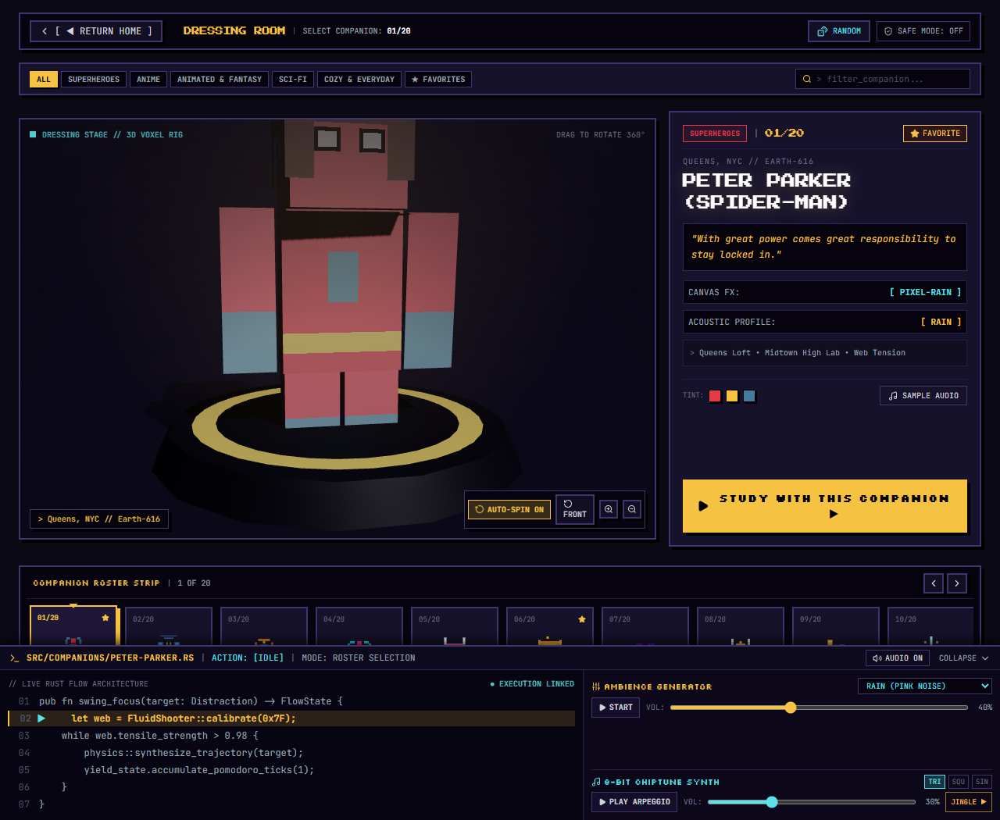
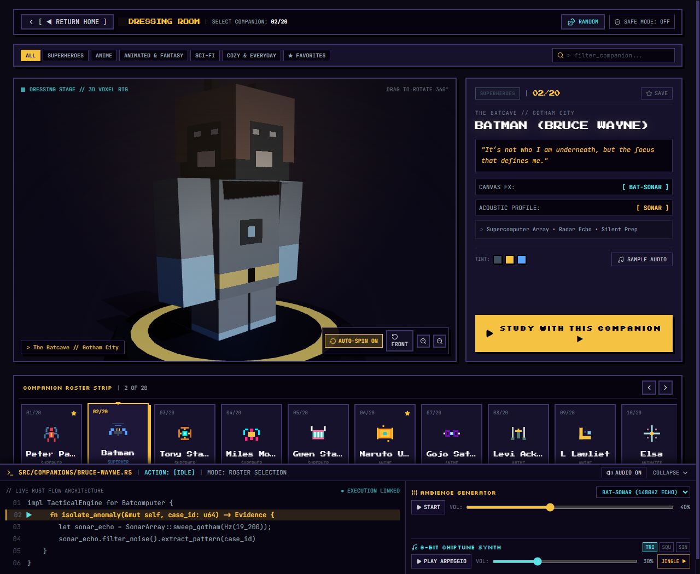
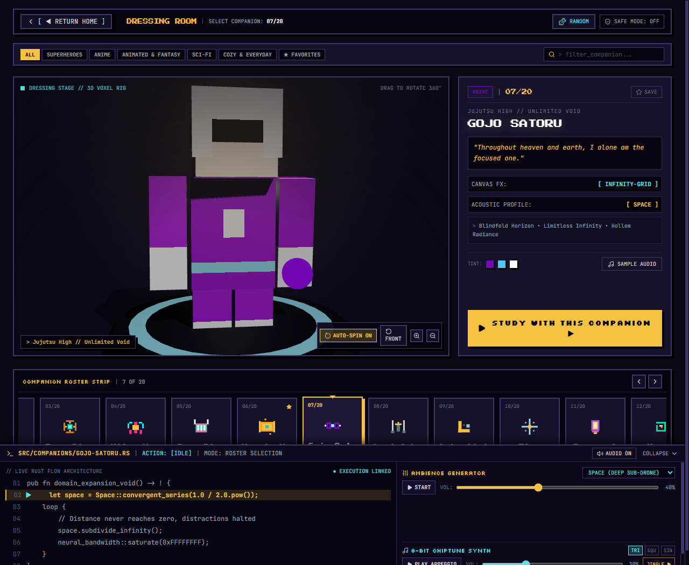
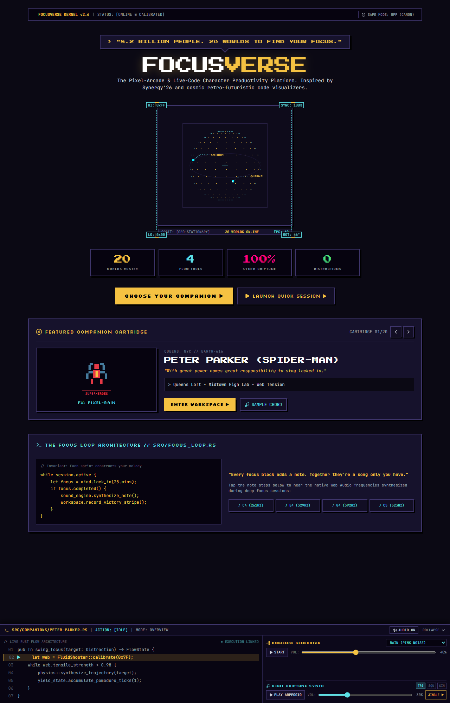

# FocusVerse // Pixel-Arcade & Live-Code Character Productivity Platform

FocusVerse is an immersive, retro-futuristic productivity environment inspired by **Synergy'26 (IIIT-Bangalore)** and cosmic live-code visualizers, featuring an interactive 3D Character Dressing Room inspired by **Minecraft Pocket Edition / Bedrock Edition**.

---

## ✦ Key Architectural Systems

### 1. Minecraft Bedrock / Pocket Edition Character Selection
* **Central 3D Voxel Stage (`CharacterVoxelStage.tsx`):**
  * Powered by **Three.js** with high-performance WebGL rendering.
  * Articulated 3D humanoid voxel avatars (and custom quadrupeds for the Cat and Dog) with authentic hairstyles, headbands, blindfolds, cloaks, and weapons.
  * Procedurally painted pixel-art textures using `THREE.NearestFilter` for razor-sharp retro edges.
  * 360° drag-to-rotate interaction with realistic angular momentum and inertia.
  * Idle breathing and subtle arm swaying animations.
  * Minecraft Bedrock dressing room style obsidian & rune platform pedestal with dynamic lighting (directional key light, spotlight, character-tinted rim backlight, and cast shadows).
  * Auto-spin toggle (`[ ↻ SPIN ]`), front view reset (`[ ↺ FRONT ]`), and interactive zoom controls.
* **Horizontal Roster Strip Carousel (`CharacterCarousel.tsx`):**
  * Horizontally scrollable strip displaying all 20 companion cartridges.
  * Auto-centers the selected character smoothly into view without vertical page displacement.
  * Keyboard navigation (`ArrowLeft` / `ArrowRight` / `ArrowUp` / `ArrowDown`).
  * Left and right step navigation buttons (`[ ◀ ]` and `[ ▶ ]`).
  * Real-time category filtering (`ALL`, `SUPERHEROES`, `ANIME`, `ANIMATED & FANTASY`, `SCI-FI`, `COZY & EVERYDAY`, `★ FAVORITES`).
  * Terminal search bar (`> filter_companion...`).
  * Instant random companion selector (`[ 🎲 RANDOM ]`).
* **Compact Information & Action Panel (`CharacterInfoPanel.tsx`):**
  * Displays companion identity, archetype name (with Copyright-Safe Mode support), universe, quote, and tagline.
  * Real-time Canvas FX mode and acoustic profile readouts.
  * Native Web Audio frequency chord sampler (`[ 🎵 SAMPLE AUDIO ]`).
  * Unmissable primary action button: `[ STUDY WITH THIS COMPANION ▶ ]`.

---

### 2. Dual-Layer Web Audio Engine (`src/utils/audioEngine.ts`)
* **100% Native Web Audio API (Zero external MP3s / Zero broken links):**
  1. **Procedural Ambience Generator:** Generates pink noise rain, hearth fire crackle, deep space drone, 22Hz therapeutic cat purr, Matrix katakana bleeps, and 1480Hz bat sonar echoes.
  2. **8-Bit Chiptune Synth Arpeggiator:** Plays non-intrusive polyphonic pentatonic chords tailored to each character with Triangle, Square, and Sine waveforms.
  3. Master mute toggle, UI click blips, task completion chimes, and retro victory jingles.

---

### 3. Study Workspaces (`src/pages/WorkspacePage.tsx`)
* **Atmosphere Canvas Layer (`EnvironmentFX.tsx`):** 20 canvas particle modes (pixel rain, matrix code, radar grid, rising lanterns, snow crystals, embers) with background dimmer slider (20% to 95%).
* **Multi-Mode Drift-Free Timer (`TimerWidget.tsx`):**
  * Pomodoro, Stopwatch (with lap recording and centiseconds), and Countdown modes.
  * `Date.now()` timestamp calculation preventing timer drift from background tab throttling.
  * Binary search progress tracker and daily focus song melody generator.
  * Retro 3-stripe sunset victory band (`#7A283B`, `#B85A32`, `#F2C14E`).
* **Persistent Task Manager (`TodoWidget.tsx`):** Priority tagging (`HIGH`, `MED`, `LOW`), `localStorage` sync, and celebratory pixel-spark canvas bursts.
* **Monospace Scratchpad (`NotesWidget.tsx`):** Real-time word and character counters with `.txt` file export.

---

## ✦ Interface Previews

| Minecraft-Inspired 3D Dressing Room | Batman Batcave Sonar Stage |
| :---: | :---: |
|  |  |

| Gojo Satoru 3D Stage | Synergy-Inspired Cosmic Landing |
| :---: | :---: |
|  |  |

---

## ✦ Getting Started

### Local Development
```bash
# Double-click run_locally.bat or run:
npm run dev -- --host
```
Server boots at `http://localhost:5173/`.

### Production Build & Preview
```bash
# Double-click build_and_preview.bat or run:
npm run build
npm run preview
```
