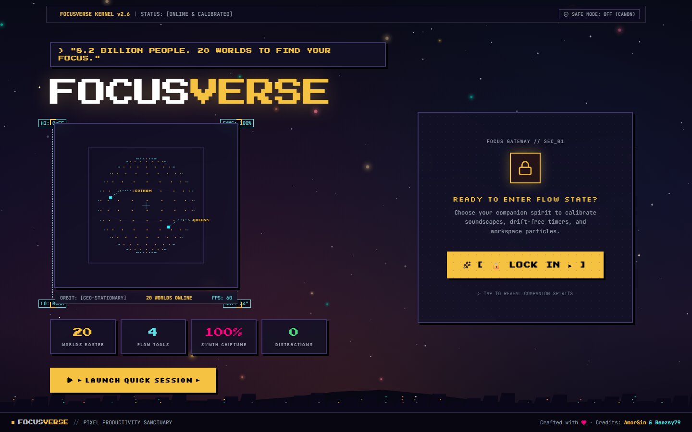
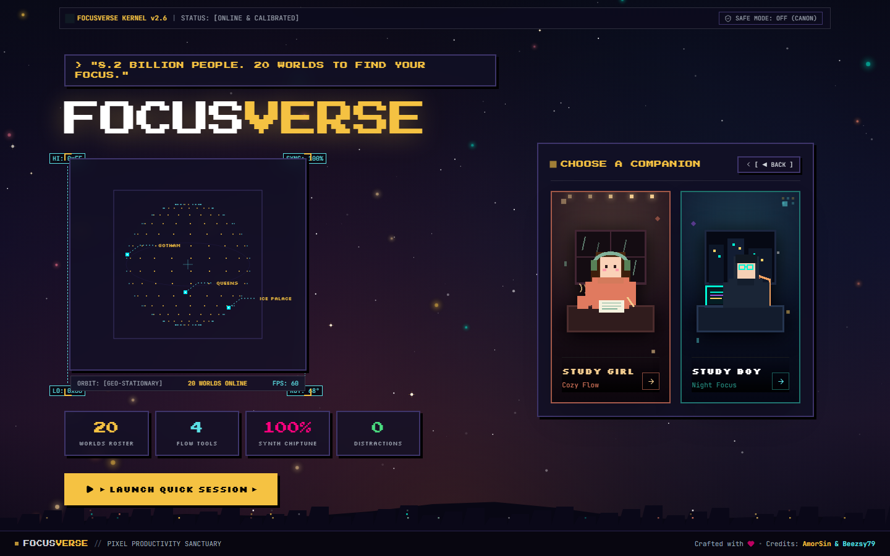
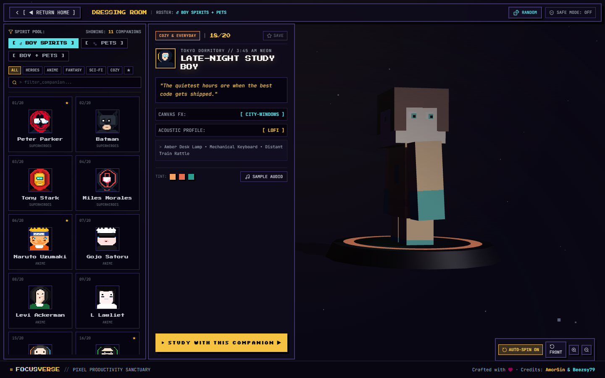
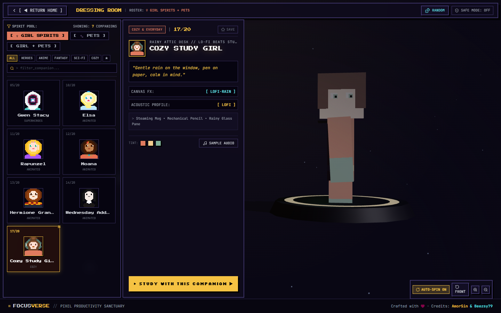
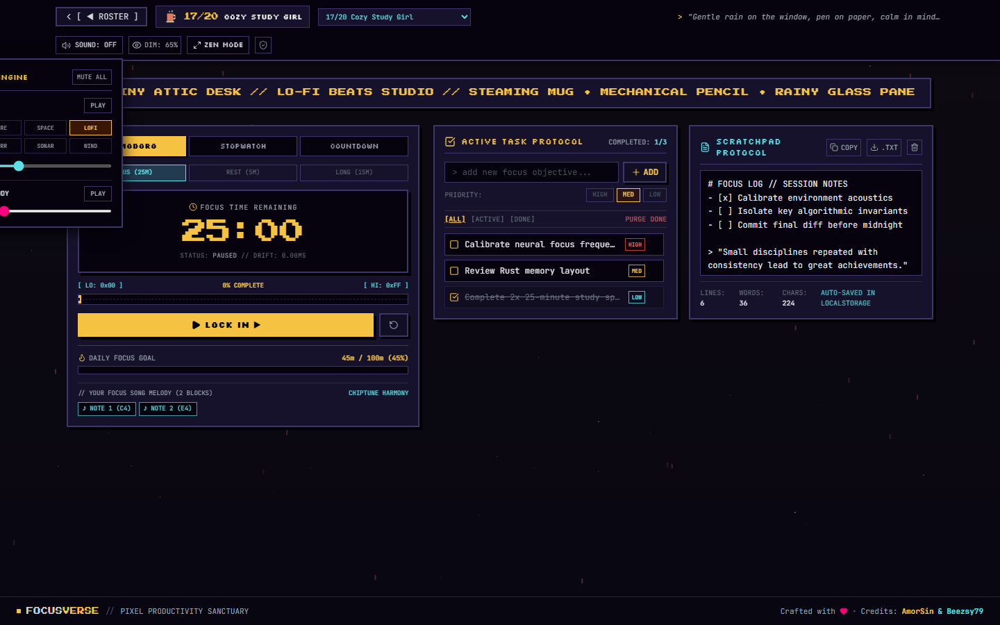

# FocusVerse // Pixel-Arcade & Live-Code Character Productivity Platform

FocusVerse is an immersive, retro-futuristic productivity environment inspired by **Synergy'26 (IIIT-Bangalore)** and cosmic live-code visualizers, featuring an interactive 3D Character Dressing Room inspired by **Minecraft Pocket Edition / Bedrock Edition**.

---

## ✦ Key Architectural Systems

### 1. Living Animated Background & Decluttered 2-Column Homepage (`HomePage.tsx`)
* **Living Animated Atmosphere (`HomeAmbientBackground.tsx`):**
  * Multi-layered twilight & aurora gradient wash (`#0B0C1E`, `#3B1D38`, `#4A2525`, `#102A3A`).
  * High-performance 60fps HTML5 Canvas with 130+ twinkling stars, mouse parallax reaction, 25+ drifting warm bokeh lanterns/fireflies, and periodic shooting star comets with glowing gradient tails.
  * Layered mountain & skyline horizon silhouette with warm flickering building windows.
  * Semi-transparent glassmorphic panels (`backdrop-blur-md bg-[#121026]/75 border border-white/15 shadow-2xl`).
* **Left Column (Decluttered Brand, Orbit & Telemetry):**
  * Live quote banner and signature retro-arcade `FOCUSVERSE` logo breathing cleanly without clutter.
  * Interactive 3D rotating pixel globe (`CosmicGlobe.tsx`) with dynamic LO/HI boundary measurement guides.
  * Segmented live counter blocks (`20 WORLDS ROSTER`, `4 FLOW TOOLS`, `100% SYNTH CHIPTUNE`, `0 DISTRACTIONS`).
  * Direct session launcher (`[ ► LAUNCH QUICK SESSION ► ]`) cleanly aligned below the stats.
* **Right Column ("LOCK IN" Gateway & Ultra-Minimalist 9:16 Cards):**
  * **Initial State:** High-impact arcade gateway box with glowing golden-amber CTA button `[ 🔒 LOCK IN ► ]`.
  * **Revealed State:** Smoothly reveals the `CHOOSE A COMPANION` heading with two adjacent ultra-minimalist portrait cards in strict `9:16` aspect ratio (`SpiritCard.tsx`):
    1. **Study Girl Spirit (`aspect-[9/16]`):** Rich sunset amber, terracotta, and rose-gold atmosphere with floating warm fairy lights, large-scale pixel art illustration, and clean bottom label (`STUDY GIRL` / `Cozy Flow` + `→`).
    2. **Study Boy Spirit (`aspect-[9/16]`):** Deep midnight sapphire, indigo, and cyan atmosphere with twinkling night-sky particles, large-scale pixel art illustration, and clean bottom label (`STUDY BOY` / `Night Focus` + `→`).
  * Selecting either card instantly navigates to the 3D Dressing Room pre-filtered to that companion spirit!

---

### 2. Docked Left Dressing Room, Scaled 3D Stage & 32x32 Pixel Portraits (`SelectPage.tsx`)
* **Far-Left Docked Pop-Up Windows (Unobstructed Viewport):**
  * Removed all `max-w-* mx-auto` centering constraints on `SelectPage.tsx`.
  * Top navigation bar stretches full-width across the viewport (`left-2 right-2`).
  * **Character Choosing Roster Pop-Up Window:** Docked flush to the far-left screen edge (`fixed left-2 top-14 bottom-11 w-[340px] z-20`) with strict spirit toggles, category pills, search input, and a 2-column roster grid.
  * **Character Description & Launch Pop-Up Card:** Docked immediately to the right of the roster (`fixed left-[352px] top-14 bottom-11 w-[350px] z-20`) with companion stats, quote, canvas FX, acoustic profile, audio sampler, and the golden launch CTA.
  * Mobile-responsive layout seamlessly allows one-tap switching between Roster and Details on screens below `1024px`.
* **Scaled-Down, Well-Proportioned 3D Stage (`CharacterVoxelStage.tsx`):**
  * Scaled down the 3D character rig and glowing pedestal by ~26% (`scale: 0.74`) and framed with an optimized camera frustum (`z = 12.0`, FOV `36°`).
  * Positioned comfortably in the open right-center space (`~68%` horizontal screen X) with generous headroom above the hair and floor clearance around the pedestal.
  * Full 360° drag-to-rotate interaction, inertia physics, auto-spin, and floating camera controls in the bottom-right corner.
* **High-Detail 32x32 Pixel Character Portraits (`PixelFaceAvatar.tsx`):**
  * Built an optimized SVG pixel engine with **Run-Length Encoded (RLE) horizontal runs** for instantaneous 60fps rendering.
  * Authentic, custom-crafted 32x32 pixel art matrices for all 20 characters (Spider-Man with tapered mask and web radiating from eyes, Batman with tall pointed bat ears and stern jaw, Tony Stark gold faceplate steps with glowing cyan visor, Miles Morales neon red web and pink-red comic lenses, Gwen Stacy pointed white hood, Naruto shinobi headband with leaf emblem and whisker marks, Gojo white spikes and blindfold, Levi undercut and cravat, L messy hair and dark eye bags, Elsa platinum braid and snowflake tiara, Rapunzel golden hair and flowers, Moana island curls and red plumeria, Hermione Gryffindor scarf, Wednesday twin braids and pointed collar, Officer K cyberpunk lighting, Neo Matrix sunglasses with specular sheen, Cozy Study Girl headphones and blushing smile, Late-Night Study Boy glowing blue-light glasses and hoodie, Purring Cat ginger fur and purring eyes, and Loyal Dog floppy ears and smiling tongue).
  * Rendered at `56x56px` inside the Roster Pop-Up cards and `48x48px` in the Description Card.

---

### 3. Study Workspaces & Header Audio Engine (`WorkspacePage.tsx`)
* **Clean Vertical Breathing Room:** Bottom drawers removed in favor of maximum vertical screen space.
* **Top Header Audio Pill:** Compact `SOUND: [ACTIVE / OFF]` control in the top HUD that toggles a floating audio engine popover:
  * Procedural Ambience Generator (`rain`, `fire`, `space`, `lofi`, `matrix`, `purr`, `sonar`, `wind`) with independent volume slider.
  * 8-Bit Chiptune Synth Melody arpeggiator with volume slider.
  * Master mute switch.
* **Atmosphere Canvas Layer (`EnvironmentFX.tsx`):** 20 canvas particle modes (pixel rain, matrix code, radar grid, rising lanterns, snow crystals, embers) with background dimmer slider (20% to 95%).
* **Multi-Mode Drift-Free Timer (`TimerWidget.tsx`):** Pomodoro, Stopwatch (with lap recording and centiseconds), and Countdown modes with timestamp calculations preventing background tab throttling.
* **Persistent Task Manager (`TodoWidget.tsx`):** Priority tagging (`HIGH`, `MED`, `LOW`), `localStorage` sync, and celebratory pixel-spark canvas bursts.
* **Monospace Scratchpad (`NotesWidget.tsx`):** Real-time word and character counters with `.txt` file export.

---

### 4. Global Credits Footer (`Footer.tsx`)
* Persistent dark pixel-arcade footer displayed across all pages:
  * `FOCUSVERSE // PIXEL PRODUCTIVITY SANCTUARY`
  * `Crafted with ♥ • Credits: AmorSin & Beezsy79`

---

## ✦ Interface Showcase

| Living Background & Decluttered Homepage | Revealed Ultra-Minimalist 9:16 Companion Cards |
| :---: | :---: |
|  |  |

| 3D Dressing Room (Docked Left • 32x32 Boy Spirits) | 3D Dressing Room (Docked Left • 32x32 Girl Spirits) |
| :---: | :---: |
|  |  |

| Workspace with Top Audio Engine Popover | Batman Batcave Sonar Stage |
| :---: | :---: |
|  |  |

---

## ✦ Getting Started

### Local Development
```bash
# Double-click run_locally.bat or run:
npm run dev -- --host
```
Server boots at `http://localhost:5173/`.

### Production Build & Preview
```bash
# Double-click build_and_preview.bat or run:
npm run build
npm run preview
```

---

## ✦ Credits
Crafted with ♥ • Credits: **AmorSin** & **Beezsy79**
